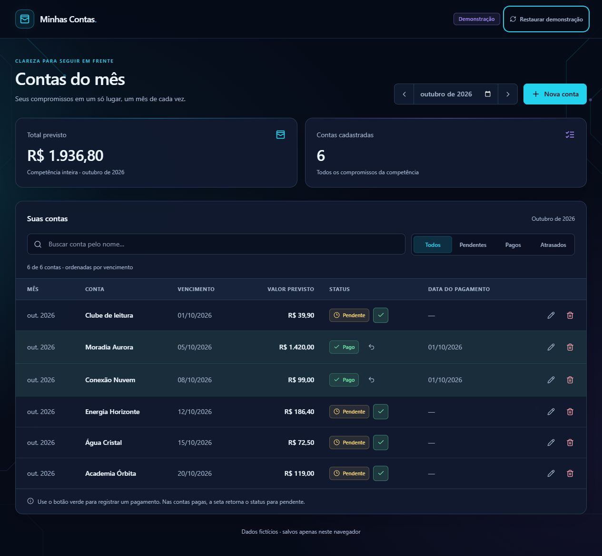

# Minhas Contas · 1.0

Aplicativo pessoal de organização financeira por competência mensal. Cadastro, edição, exclusão e pagamentos ficam em uma interface em português, com tabela no desktop e cartões no celular.

Código público: [Alonso0011/minhas-contas-local](https://github.com/Alonso0011/minhas-contas-local). O aplicativo e as contas são locais; o repositório contém somente código, exemplos fictícios e documentação.

A versão 1.0 acrescenta busca por nome, filtros Todos/Pendentes/Pagos/Atrasados e uma demonstração isolada para portfólio. Os dois indicadores — Total previsto e Contas cadastradas — sempre representam a competência inteira. A ordenação por vencimento é preservada.

## Identidade e acessibilidade

Fundo azul profundo, painéis escuros, destaque ciano e detalhes violeta. Tokens de cores, espaçamento e movimento ficam em `frontend/src/styles.css`. O fundo geométrico é um SVG local; não há imagens remotas ou bibliotecas de animação. Transições curtas e movimento ambiente respeitam `prefers-reduced-motion`.

Contas pagas têm a linha ou cartão verde, texto Pago e data visível. Atrasadas têm indicação textual vermelha. Formulários possuem labels, modais contêm o foco e o devolvem ao fechar, e ações de ícone têm nomes acessíveis.

### Capturas da demonstração

As imagens abaixo usam exclusivamente dados fictícios da demo.



<details>
<summary>Ver captura no celular</summary>


</details>

## Arquitetura

```text
backend/app/core/           Configuração
backend/app/db/             Conexão com o banco
backend/app/modules/bills/  Modelo, schemas, serviço e rotas
backend/alembic/            Migrations
backend/tests/              Testes com banco temporário
frontend/src/features/bills/ Interface, fontes de dados, tipos e regras
frontend/tests/             Testes da demo e filtros
scripts/smoke_api.py        Smoke HTTP
iniciar.ps1                Iniciador pessoal para Windows
```

Backend: Python 3.11+, FastAPI, SQLAlchemy 2, Pydantic 2, Alembic, SQLite e pytest. Frontend: React, TypeScript, Vite, integração oficial Tailwind/Vite, Lucide e fetch nativo. O estado permanece nos componentes React.

A mesma interface utiliza o contrato `BillsDataSource`: API no modo `personal`, localStorage no modo `demo`. A seleção acontece no build do Vite. Não há novos módulos financeiros nesta versão; evoluções estão no [roadmap](docs/ROADMAP.md).

## Requisitos e instalação

- Python 3.11 ou superior, com venv e pip.
- Node.js 22.12 ou superior.
- pnpm 11.25.0 para instalar com o lockfile existente. Os scripts também aceitam `npm run` após a instalação.

Na raiz, prepare o backend (PowerShell):

```powershell
cd backend
python -m venv .venv
.\.venv\Scripts\python.exe -m pip install -e ".[dev]"
Copy-Item .env.example .env
.\.venv\Scripts\python.exe -m alembic upgrade head
cd ..\frontend
pnpm install --frozen-lockfile
Copy-Item .env.example .env
npm run build
cd ..
```

Copie os modelos `.env.example` somente na primeira configuração, preservando arquivos `.env` existentes. Não execute seed no banco pessoal atual.

No Linux/macOS, use `python3 -m venv .venv`, `.venv/bin/python` e `cp` no lugar dos comandos correspondentes. Os demais comandos de instalação são os mesmos.

## Uso pessoal no Windows

Depois da preparação, crie os atalhos uma vez, na raiz do projeto:

```powershell
powershell -NoProfile -ExecutionPolicy Bypass -File .\criar-atalho.ps1
```

Dê dois cliques em **Minhas Contas** na área de trabalho. Os serviços iniciam em segundo plano e o navegador padrão abre quando estiverem prontos. Uma nova abertura reutiliza os serviços existentes, sem duplicá-los. Fechar o navegador não encerra os serviços nem apaga contas. Use **Encerrar Minhas Contas**, também na área de trabalho, para encerrar somente os processos registrados por este projeto.

Os atalhos são criados na pasta de área de trabalho informada pelo Windows, inclusive quando redirecionada ao OneDrive. Caminhos com espaços e acentos são suportados, e o ícone local fica em `assets/minhas-contas.ico`. O atalho guarda o caminho do Node encontrado durante a criação. Se mover o projeto ou reinstalar o Node, recrie os atalhos. Não são necessários privilégios de administrador; `ExecutionPolicy Bypass` vale apenas para aquele processo, sem mudar a política do Windows.

Para usar pelo PowerShell, sem atalhos:

```powershell
.\iniciar.ps1
.\encerrar.ps1
.\iniciar.ps1 -CheckOnly
.\iniciar.ps1 -NoBrowser
.\iniciar.ps1 -ApiPort 18000 -FrontendPort 15173 -SmokeTest
```

O iniciador verifica dependências, build, banco e portas. Usa a interface já compilada de `frontend/dist/`, não instala dependências, não executa migrations ou seed e não precisa de internet após a instalação. Os dois serviços escutam somente em **127.0.0.1**. Se uma porta estiver ocupada por outro programa, mostra o conflito e preserva esse programa. Logs e o registro dos processos ficam em `.local/`, ignorada pelo Git. Falhas pelo atalho aparecem em uma caixa de mensagem.

`-SmokeTest` inicia API e frontend, verifica a comunicação via proxy e encerra somente os processos criados para o teste. Se o aplicativo já estiver aberto, apenas verifica a instância existente. Para portas alternativas, use `-ApiPort 8001 -FrontendPort 5174` após encerrar a instância anterior. Se a política local bloquear scripts, use `powershell -NoProfile -ExecutionPolicy Bypass -File .\iniciar.ps1` somente nessa execução.

O SQLite padrão fica em **`backend/minhas_contas.db`**, ancorado na pasta do projeto, independentemente da pasta de trabalho do atalho. Os dados sobrevivem ao fechamento do navegador e ao reinício do computador. Após reiniciar o Windows, abra o atalho novamente; não há inicialização automática no login. Em pastas do OneDrive, mantenha o projeto e suas dependências disponíveis neste dispositivo. O aplicativo não implementa sincronização de dados entre computadores; evite abrir o mesmo SQLite em duas máquinas.

Após alterar o frontend, encerre o aplicativo, execute `npm run build` em `frontend/` e abra novamente. O uso local não exige hospedagem, login ou conta de usuário.

Alternativa manual, inclusive para Linux/macOS: no terminal do backend, rode `python -m uvicorn app.main:app --reload --host 127.0.0.1 --port 8000` com o Python do ambiente virtual. Em outro terminal, na pasta frontend, execute `npm run dev` ou `pnpm dev`.

## Demonstração para compartilhar

O modo padrão é `personal`. O modo `demo` é selecionado por `--mode demo` durante o build; ele não pode ser ativado por parâmetros de URL e não faz chamadas ao backend pessoal.

Na primeira abertura, são criadas seis contas exclusivamente fictícias no mês atual. Cadastro, edição, exclusão e pagamentos persistem somente na chave `minhas-contas:demo:v1` do localStorage da origem atual. Recarregar preserva os dados. A opção **Restaurar demonstração** exige confirmação, substitui apenas essa chave e volta ao mês atual. Outras chaves e o banco pessoal permanecem intocados. Não digite informações reais no ambiente de demonstração.

A partir de `frontend/`:

```powershell
npm run dev:demo
npm run build:demo
npm run preview:demo
```

Os mesmos scripts funcionam com `pnpm run dev:demo`, `pnpm run build:demo` e `pnpm run preview:demo`. Uma instalação padrão de Node inclui npm; ambientes que disponibilizam somente pnpm podem usar esses equivalentes. O projeto mantém `pnpm-lock.yaml`.

| Comando | Saída | Fonte dos dados |
| --- | --- | --- |
| `npm run build` | `frontend/dist/` | API pessoal |
| `npm run build:demo` | `frontend/dist-demo/` | localStorage da demo |

### Publicação da demo

1. Execute `npm run build:demo` na pasta frontend.
2. Envie somente o conteúdo de `frontend/dist-demo/` à hospedagem estática escolhida.
3. Configure essa pasta como diretório publicado e `index.html` como entrada.
4. Abra o endereço fornecido pela hospedagem e confira os fluxos.

Assets usam caminhos relativos, inclusive para hospedagem em subdiretórios. Não são necessários backend, banco, segredos ou rewrites de rotas. Revise localmente com `preview:demo`; abrir o HTML por `file://` não substitui um servidor HTTP.

O repositório contém o código; ele não hospeda o aplicativo. Publicar a demo em hospedagem estática é um passo opcional separado para obter um link interativo público. Não publique `dist/` como demonstração e não envie o diretório inteiro do projeto.

## Configuração

| Local | Variável | Padrão / uso |
| --- | --- | --- |
| `backend/.env` | `DATABASE_URL` | `sqlite:///./minhas_contas.db`, relativo à pasta backend |
| `backend/.env` | `CORS_ORIGINS` | Lista JSON: `["http://localhost:5173","http://127.0.0.1:5173"]` |
| `frontend/.env` | `VITE_API_BASE_URL` | `/api/v1`, utilizado somente no modo pessoal |
| Ambiente do Vite | `API_PROXY_TARGET` | `http://127.0.0.1:8000`; o iniciador ajusta para a porta escolhida |

O Vite encaminha `/api` ao backend no modo pessoal. Ao usar uma URL absoluta em `VITE_API_BASE_URL`, inclua a origem do frontend em `CORS_ORIGINS`. Reinicie os servidores depois de alterar configurações. A demo ignora a URL da API e não configura esse proxy.

O modo pessoal destina-se ao uso local e não possui autenticação. PostgreSQL, autenticação e deploy do backend permanecem no roadmap; `DATABASE_URL` prepara a configuração para essa evolução.

## Migrations e exemplos fictícios

A partir de backend, com o Python do ambiente virtual:

```powershell
python -m alembic upgrade head
python -m alembic check
```

`python` representa `.\.venv\Scripts\python.exe` no Windows e `.venv/bin/python` no Linux/macOS. Para um banco separado de exemplos, configure `DATABASE_URL`, aplique as migrations e execute `python -m app.seed`.

O seed versionado contém dez contas fictícias de setembro de 2026, totalizando 237570 centavos. É idempotente por nome e competência, preservando registros encontrados. Ele não é executado pelo iniciador. O banco pessoal existente não é alterado pela substituição dos exemplos no código.

## Backup e restauração do SQLite

Na raiz, crie um backup consistente com a API de backup do SQLite, incluindo alterações confirmadas mesmo em modo WAL. O comando respeita `DATABASE_URL`, abre o banco de origem somente para leitura e verifica a integridade da cópia:

```powershell
powershell -NoProfile -ExecutionPolicy Bypass -File .\backup.ps1
```

O arquivo será criado em `backups/minhas-contas-AAAAmmdd-HHMMSS-microssegundos.db`. Faça backup antes de atualizar migrations ou substituir dados. Para restaurar, encerre os serviços, confirme que nenhuma outra instância usa o banco e faça primeiro um backup do estado atual. Na configuração padrão:

```powershell
.\encerrar.ps1
.\backup.ps1
Copy-Item -LiteralPath 'backups/SEU-BACKUP.db' -Destination 'backend/minhas_contas.db'
.\iniciar.ps1
```

Se `DATABASE_URL` aponta para outro arquivo, use esse caminho na restauração. Não substitua o arquivo enquanto houver conexões abertas. Se ativou WAL manualmente, finalize as conexões e o checkpoint antes da restauração para não reaplicar um journal antigo.

Bancos, backups, configurações privadas, logs e builds são ignorados pelo Git. `.gitignore` não retira arquivos já rastreados nem apaga histórico; revise o conteúdo antes de publicar. Nenhum arquivo pessoal foi apagado e nenhum histórico foi reescrito.

## Regras e API

Dinheiro é persistido em centavos inteiros positivos. Competência, vencimento e pagamento são datas `YYYY-MM-DD`, sem conversão para UTC. A competência é normalizada para o primeiro dia e o vencimento deve pertencer ao mesmo mês.

Somente `PENDING` e `PAID` são persistidos. Atraso é calculado quando uma conta pendente venceu antes de hoje. Marcar Pago preenche a data atual se nenhuma foi informada; a data pode ser editada. Retornar a Pendente sempre limpa o pagamento.

Todas as rotas ficam sob `/api/v1`:

| Método | Endpoint | Uso |
| --- | --- | --- |
| GET | `/health` | Saúde da API |
| GET | `/bills?month=2026-09` | Contas do mês |
| GET | `/bills/summary?month=2026-09` | Total e quantidade |
| GET | `/bills/{id}` | Consulta |
| POST | `/bills` | Cadastro |
| PATCH | `/bills/{id}` | Edição parcial e pagamento |
| DELETE | `/bills/{id}` | Exclusão |

Exemplo fictício de cadastro:

```json
{"name":"Conexão Nuvem","reference_month":"2026-09-01","due_date":"2026-09-08","amount_cents":9900,"status":"PENDING"}
```

No PATCH, use `{"status":"PAID"}` para registrar hoje, acrescente `"paid_at":"2026-09-08"` para informar outra data ou envie `{"status":"PENDING"}` para desfazer. Dados inválidos retornam HTTP 422 e contas inexistentes, HTTP 404. Schemas completos estão em `/docs` da API.

## Testes e verificações

Na pasta backend, com o Python do ambiente virtual:

```powershell
python -m pytest
python -m ruff check .
python -m ruff format --check .
```

Na pasta frontend:

```powershell
pnpm test
pnpm lint
pnpm typecheck
pnpm build
pnpm build:demo
```

Os testes do backend usam banco temporário. Os novos testes da demo cobrem persistência, isolamento, restauração, CRUD, datas, falha de gravação e filtros combinados. Não precisam da API.

Com uma API de teste em execução, rode `python scripts/smoke_api.py --base-url http://127.0.0.1:8000/api/v1` a partir da raiz. Esse script cria e remove uma conta temporária; use um banco de teste para preservar integralmente os dados pessoais. A opção `--check-seed` valida exclusivamente o novo seed fictício, não um banco pessoal anterior.

Para capturas de portfólio e revisão visual, utilize somente `preview:demo`. Confira desktop/celular, teclado, foco, pagamentos, busca, filtros, recarga, restauração e preferência de redução de movimento.

### Validação do uso local no Windows

Encerre o aplicativo antes de executar o teste de integração do lançador:

```powershell
powershell -NoProfile -ExecutionPolicy Bypass -File .\scripts\test-launcher.ps1
```

O teste cria um SQLite temporário em `.local/`, usa portas 18000/15173 e remove apenas seu próprio banco ao terminar. Verifica execução a partir de outra pasta, reabertura sem duplicatas, escuta em 127.0.0.1, persistência de valor e pagamento após reiniciar os serviços, encerramento e conflito com uma porta alheia.

Validação realizada no Windows PowerShell 5.1: teste do lançador aprovado; criação dos dois atalhos na área de trabalho redirecionada ao OneDrive, leitura do ICO pelo Windows, abertura, reabertura e encerramento pelos atalhos aprovados. O banco pessoal permaneceu com a mesma assinatura dos registros após os testes, e um backup consistente foi criado com integridade verificada. O reinício testado foi dos serviços, sem reiniciar o computador. A chamada ao navegador padrão foi executada pelo atalho; não foi feita captura da interface com dados pessoais. O aplicativo não faz downloads na inicialização; não foi desligada a conexão de rede do computador durante o teste.

### Resultado da validação da versão 1.0

- Backend: 40 testes aprovados, Ruff lint e formatação aprovados. Migrations e seed fictício idempotente foram exercitados em bancos temporários.
- Frontend: 9 testes aprovados, ESLint e TypeScript aprovados; builds pessoal e demo gerados em pastas separadas.
- Iniciador: detecção de porta ocupada e smoke completo em portas alternativas aprovados; as portas abertas pelo smoke foram liberadas ao terminar.
- Demo: CRUD, pagamentos, edição manual da data, recarga, busca, filtros, mudança de mês, lista vazia e restauração verificados no navegador. O contrato da demo foi testado com qualquer acesso à rede bloqueado, e o bundle não contém a URL ou o prefixo da API pessoal.
- Interface: desktop e celular verificados, incluindo larguras de 320 e 390 pixels sem rolagem horizontal da página. Foco inicial, circulação com Tab/Shift+Tab nos diálogos e retorno ao botão de origem com Escape aprovados; console sem erros ou avisos.
- Preservação: a assinatura dos registros do SQLite pessoal permaneceu idêntica à obtida antes das alterações.

O ambiente de testes emitiu apenas o aviso de depreciação Starlette/httpx já existente. A regra CSS para `prefers-reduced-motion` foi revisada; a ferramenta de navegador disponível não oferece emulação dessa preferência, portanto a ativação pelo sistema operacional não foi testada aqui.
